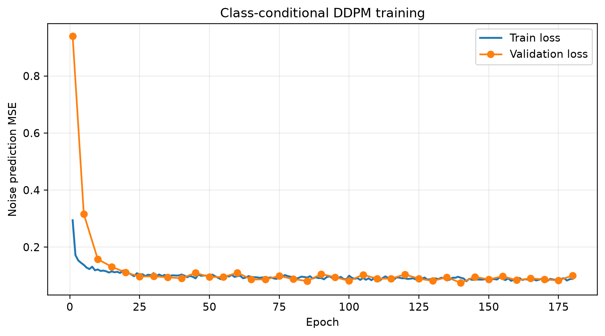
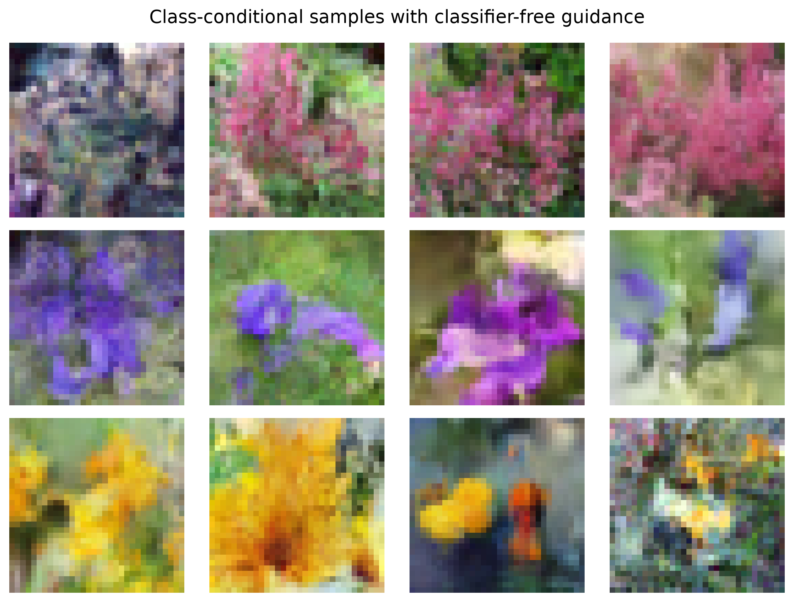
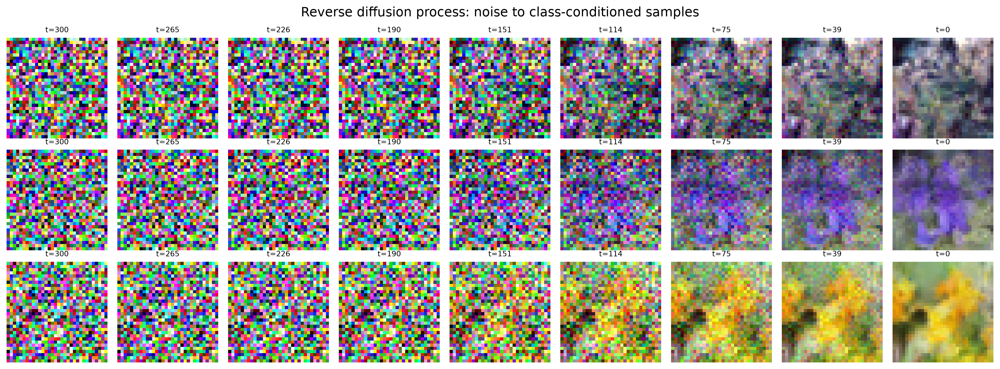

# MLlab2026 Diffusion Bonus Report

## 任务

将基础 DDPM 扩展为三类花的类别条件扩散模型，通过类别标签控制生成结果。

## 创新点

- 时间步 embedding 与类别 embedding 联合注入残差块的缩放和偏置。
- Classifier-free guidance：训练时以 10% 概率丢弃标签。
- EMA 权重用于验证和最终采样。
- 使用 100 步确定性 DDIM 采样减少高频伪影。
- 输入分辨率提升为 32 x 32。

## 设置

- 训练图像：2070
- 验证图像：518
- Epoch：180
- 扩散步数：300
- 引导强度：2.5
- 最佳 epoch：140
- 最佳验证损失：0.07481

## 结果

## 局限

32 x 32 分辨率和有限数据规模使细节受限；本实验重点验证条件生成范式和
完整的训练、EMA、guidance、保存及可视化链路。
