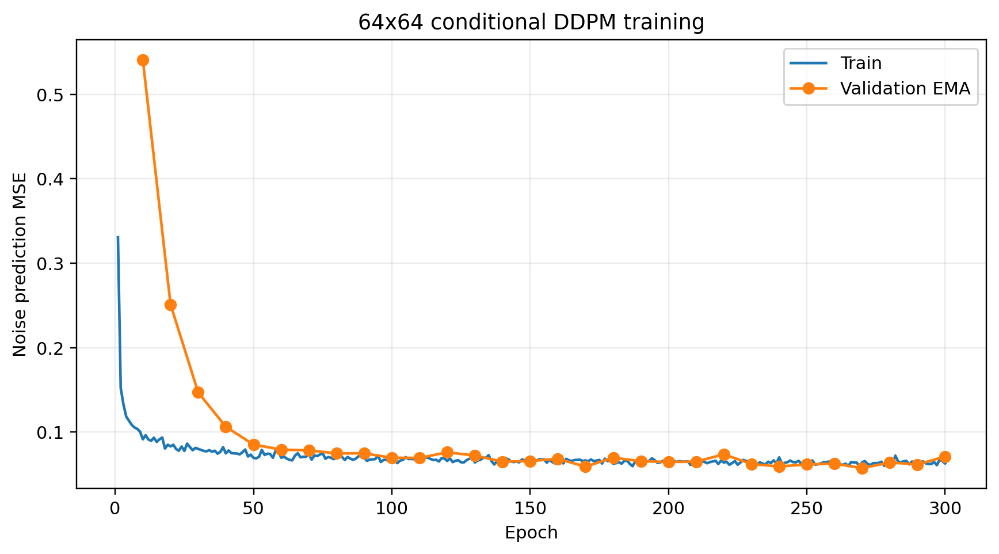
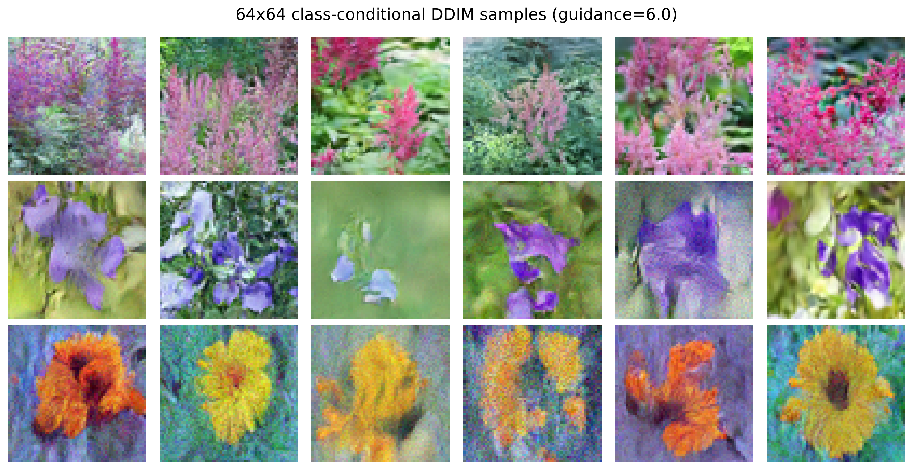
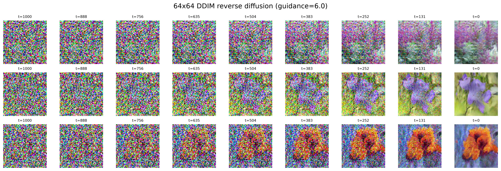

# MLlab2026 Kaggle High-Resolution Diffusion Report

## 目标

在 Kaggle Tesla T4 上训练 64 x 64 类别条件 DDPM，验证更充足算力与 DDIM 采样
是否能够明显改善生成质量。

## 方法

- 三级残差 U-Net，最低层加入自注意力。
- 时间步 embedding、类别 embedding 与 AdaGN 条件调制。
- Classifier-free guidance，标签 dropout 10%。
- guidance 对比：2.5 -> 86.1%，4.0 -> 86.1%，6.0 -> 97.2%；最终使用 6.0。
- EMA 权重与 100 步确定性 DDIM。
- 留出集分类器评估类别条件一致性。

## 指标

- GPU：Tesla T4
- 图像尺寸：64 x 64
- 验证损失：0.05733
- 分类器验证准确率：90.0%
- 条件一致性：97.2%

